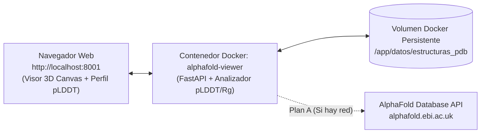

# AlphaFold-Lite Pocket Viewer — Microservicio Contenerizado de Análisis Estructural 3D

**Instituto Tecnológico de Ocotlán**  
**Materia:** Sistemas Programables  
**Práctica:** Laboratorio Práctico con Docker (Despliegue de Aplicación Contenerizada)  

---

## 1. Explicación del Proyecto y Fundamento Científico

**AlphaFold-Lite Pocket Viewer** es un microservicio web contenerizado en Docker para la inspección tridimensional de proteínas y el cálculo de métricas de confianza estructural, inspirado en **AlphaFold** de **Google DeepMind** (galardonado con el Premio Nobel de Química 2024).

En los modelos predichos por AlphaFold, cada residuo de aminoácido (representado geométricamente por su carbono alfa, $C_\alpha$) incluye una métrica de confianza local denominada **pLDDT (*predicted Local Distance Difference Test*)** en una escala de `0` a `100`, almacenada en la columna *B-factor* de los archivos en formato **PDB (*Protein Data Bank*)**.

### Función de la Aplicación
1. **Adquisición Resiliente de Estructuras 3D (`GET /api/proteina/{uniprot_id}`):**
   - **Plan A (API oficial de AlphaFold Database en EMBL-EBI):** Descarga en tiempo real el archivo `.pdb` correspondiente al identificador UniProt (`P69905` Hemoglobina alfa, `P01308` Insulina humana, `P01542` Crambina, `P04637` Supresor tumoral p53) desde `https://alphafold.ebi.ac.uk/api/prediction/` y lo guarda en el volumen persistente de Docker.
   - **Plan B (Contingencia Determinista Local):** Si el laboratorio no cuenta con conexión a internet durante la revisión, sintetiza un modelo tridimensional determinista con coordenadas $C_\alpha$ plegadas y perfil `pLDDT` realista, garantizando disponibilidad del 100%.
2. **Cálculo de Métricas Biofísicas y Bandas de Confianza de Google DeepMind:**
   - Calcula el **pLDDT global promedio** y el **Radio de Giro ($R_g$ en Ångströms, $\text{\AA}$)** a partir de las coordenadas espaciales $(x, y, z)$.
   - Clasifica cada residuo en las **4 bandas oficiales de confianza de AlphaFold**:
     - **Muy alta ($\text{pLDDT} \ge 90$, Azul oscuro):** Alta precisión atómica en el núcleo plegado.
     - **Confiable ($70 \le \text{pLDDT} < 90$, Celeste):** Plegamiento de cadena principal bien definido.
     - **Baja ($50 \le \text{pLDDT} < 70$, Amarillo):** Lazos flexibles de baja certidumbre.
     - **Muy baja ($\text{pLDDT} < 50$, Naranja):** Regiones intrínsecamente desordenadas (*IDR*).
3. **Visor 3D Interactivo en HTML5 Canvas (`GET /`):** Renderiza en tiempo real el esqueleto peptídico 3D coloreado por banda `pLDDT` con rotación interactiva mediante el mouse, sin depender de librerías externas en CDN que puedan fallar sin red.
4. **Síntesis Estructural Asistida por IA (`POST /api/interpretar/{uniprot_id}`):** Genera un resumen biofísico explicando la estabilidad de la proteína utilizando `openai/gpt-oss-120b` en Groq o el analizador determinista local.

---

## 2. Explicación de la Implementación y Objetivo de Docker

### ¿Cuál es el objetivo de utilizar Docker en este proyecto?
1. **Empaquetado Estandarizado del Microservicio Científico:** Garantiza que el servidor **FastAPI**, el motor de análisis geométrico $C_\alpha$ y el visor 3D se ejecuten exactamente con la misma versión de Python (`python:3.12-slim`) y dependencias (`requirements.txt`) en las computadoras de los 3 integrantes del equipo.
2. **Caché Persistente de Estructuras mediante Volúmenes Docker:** Al montar el volumen `volumen_estructuras_pdb:/app/datos/estructuras_pdb`, cada proteína descargada o generada se almacena en disco fuera de la capa efímera del contenedor. Si el contenedor se reinicia, las estructuras se sirven instantáneamente desde `CACHE_VOLUMEN_DOCKER`.
3. **Seguridad y Monitoreo Automático (`HEALTHCHECK`):** El contenedor se ejecuta bajo un usuario sin privilegios (`appuser`, UID `1000`) y expone el puerto `8001` con una sonda de salud nativa cada 15 segundos hacia `/api/salud`.



---

## 3. Estándares de Ingeniería Aplicados

El código en [`app/main.py`](./app/main.py) adopta la **[Google Python Style Guide](https://google.github.io/styleguide/pyguide.html)** y las prácticas de **Ingeniería de Investigación (*Research Engineering*)** de Google Research y Google DeepMind:
- **Tipado estático estricto (`PEP 484` / `PEP 604`)** y *docstrings* estructurados.
- **Configuración inmutable (`@dataclass(frozen=True)`)** en `ConfiguracionAlphaFold`.
- **Contratos de datos inmutables (`pydantic.BaseModel` con `frozen=True`)** en `ResiduoCA`, `DistribucionBandasPLDDT`, `ReporteEstructuralProteina` e `InterpretacionIA`.
- **Pruebas unitarias deterministas ([`tests/test_alphafold.py`](./tests/test_alphafold.py))** para validar la clasificación de bandas `pLDDT` y el cálculo del radio de giro $R_g$.

---

## 4. Instrucciones de Despliegue con Docker

### Opción A: Con Docker Compose (Recomendado)

```bash
# 1. Entrar al directorio del proyecto
cd alphafold-pocket-viewer

# 2. Construir la imagen e iniciar el contenedor
docker compose up --build -d

# 3. Verificar estado del contenedor
docker compose ps

# 4. Abrir el visor 3D en el navegador:
# http://localhost:8001
```

### Opción B: Con `docker build` y `docker run`

```bash
docker build -t alphafold-pocket-viewer:1.0 .
docker run --rm -p 8001:8001 --name alphafold-viewer alphafold-pocket-viewer:1.0
```

---

## 5. Guía de Revisión para el Equipo (3 Integrantes · Viernes)

| Integrante | Rol en la Revisión | Qué mostrar y explicar (2 min) |
| :--- | :--- | :--- |
| **Integrante 1** | **Función y Fundamento en AlphaFold** | Abrir `http://localhost:8001`, rotar con el mouse la estructura 3D de la **Hemoglobina (`P69905`)** y cambiar en el selector al **Supresor tumoral p53 (`P04637`)** para mostrar cómo cambian los colores de las 4 bandas `pLDDT` (azul oscuro para el núcleo rígido vs. amarillo/naranja en regiones flexibles) y presionar **"Generar Síntesis Estructural con IA"**. |
| **Integrante 2** | **Implementación del `Dockerfile`** | Explicar línea por línea el [`Dockerfile`](./Dockerfile): por qué se usa `python:3.12-slim`, por qué se copia `requirements.txt` antes del código (caché de capas), por qué se usa el usuario `appuser` (seguridad no-root) y cómo funciona la instrucción `HEALTHCHECK`. |
| **Integrante 3** | **Objetivo de Docker y Persistencia (`docker-compose.yml`)** | Explicar [`docker-compose.yml`](./docker-compose.yml): cómo el mapeo de puertos `8001:8001` conecta la red del contenedor con el navegador anfitrión y cómo el volumen `volumen_estructuras_pdb` guarda en caché los archivos `.pdb` (mostrando en la pantalla que la fuente cambia a `CACHE_VOLUMEN_DOCKER` al recargar una proteína). |

---

## 6. Referencias Académicas, Libros y Literatura Científica

Para una comprensión exhaustiva de la biofísica de proteínas, el funcionamiento matemático de AlphaFold y el aprendizaje profundo geométrico, consulta el compendio formal en:

📄 **[REFERENCIAS.md](./REFERENCIAS.md)**

### Principales Obras de Referencia:
1. **Bioquímica y Plegamiento:** *Lehninger Principios de Bioquímica* (Nelson & Cox, Caps. 3 y 4) y *Biología Molecular de la Célula* (Alberts et al., Cap. 3).
2. **Biología Estructural Computacional:** *Introduction to Protein Structure* (Brändén & Tooze) y *Structural Bioinformatics* (Gu & Bourne, formato PDB y deducción de $R_g$).
3. **Aprendizaje Geométrico e IA 3D:** *Geometric Deep Learning* (Bronstein et al., MIT Press, invarianza $SE(3)$).
4. **Artículos Fundacionales:** Jumper et al. (*Nature*, 2021, AlphaFold 2) y Mariani et al. (*Bioinformatics*, 2013, métrica lDDT).
5. **Cursos y Manuales:** [EMBL-EBI AlphaFold Training](https://www.ebi.ac.uk/training/online/courses/alphafold/) y [PDB-101 Educational Portal](https://pdb101.rcsb.org/).

